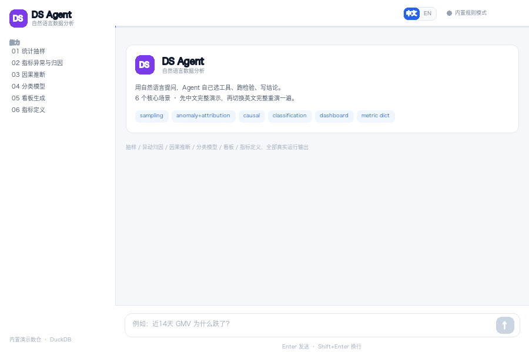

# DS-Agent

<div align="center">

**面向业务的数据分析架构 Agent** · **A business-oriented analytics agent**

LLM 负责意图识别与任务分发，确定性代码负责执行与统计结论，失败自动重规划
· **LLM recognizes intent & dispatches tasks; deterministic code executes; failures re-plan**

🇨🇳 中文默认展开 · 🇬🇧 English collapsed · 点击标题切换 / click a section header to toggle

</div>

> ⚠️ **人工核对声明 / Human review pending**
>
> 本项目（包括代码、文档与演示内容）由 AI 辅助生成，**尚未经过人工核对审查**。
> 统计方法的正确性以可运行的测试与金标准评测集为准，观点与结论请自行验证后再采用。
>
> This project — code, docs and demo content — is AI-generated and **has not yet been
> human-reviewed**. Statistical correctness is backed by runnable tests and a frozen
> benchmark; verify claims before relying on them.

> 🎨 **Vibe Coding 作品 / Built by Vibe Coding**
>
> 本项目由人类提出需求、场景与验收标准，AI 全程编码实现——从统计引擎、因果推断工具到 Web
> 界面与演示动图，均为人机对话式协作的产物。**335 个自动化测试**是这套协作方式的可以跑通的证明。
>
> This project was built vibe-coding style: a human steering with requirements and acceptance
> criteria, an AI writing all the code — stats engines, causal tools, web UI and demo GIF alike.
> The **335 automated tests** are the proof receipt of that collaboration could work.

所有数字都来自确定性、经过测试的统计代码，不靠大模型"编"；没有 LLM 也能完整跑通。
Every number comes from deterministic, tested code — the LLM is optional.

---

<details open>
<summary><b>🇨🇳 中文</b>（点击收起 / collapse）</summary>

### 能力一览

| 领域 | 能干什么 | 你可以这么问 |
| --- | --- | --- |
| **问数与口径** | 语义层统一指标口径的 NL 查数（只读 SQL、自动限行）；指标字典注册即全链路生效；业务知识 RAG 问答 | 「近30天各渠道 GMV 排名」「注册指标：利润率 = …」 |
| **异动诊断** | 季节性异常检测（稳健 z + CUSUM，可切 Holt-Winters/SARIMA/STL，auto 回测择优；另有自编码器 + 孤立森林）；贡献度分解；3 层根因下钻决策树 | 「近7天 GMV 为什么跌了？」 |
| **实验科学** | 15 种实验设计（AB / switchback / 序贯 / 反转 / 父子 / 双边市场…）；读数含 SRM、CUPED、BH-FDR、分群异质性；敏感性分析套件；置信度验证卡 | 「设计一个转化率实验」「看下这个 AB 实验的结果」 |
| **因果推断** | DiD(TWFE)、PSM、IPW/AIPW、合成控制、断点回归、中断时序、Uplift 因果森林（Qini）；DoWhy 开源引擎交叉验证 + 安慰剂反驳检验 | 「用双重差分评估补贴政策的影响」 |
| **抽样调查** | Cochran 样本量（比例/均值 + 敏感性表）；简单随机/系统/分层抽样（可复现）；标准误、95% CI、代表性检验（卡方 / Welch t / KS） | 「基线70%检测3个百分点，需要多少样本？」 |
| **建模分析** | 端到端闭环（回归与因果共用预处理）：标签定义与泄漏检查 → 预处理（缺失值/NaN）→ 特征工程（独热 + 共线性剪枝 \|r\|>0.95、VIF>10）→ 强基线 → 分层 5 折 CV + 留出检验 + 概率校准（Brier/ECE）→ 事后 SHAP / 置换重要性 | 「训练分类模型预测用户是否转化」 |
| **模型监控** | 上线体检：特征漂移 PSI 分级（>0.10 警告 / >0.25 重训）、数据漂移 KS 检验、性能衰减（分层 AUC 趋势）、告警清单与重训建议 | 「检查转化模型的特征漂移和性能衰减」 |
| **交付与引导** | 一键独立 HTML 监控看板；结论先行的 Markdown + HTML 周报；方法选型决策树顾问；30+ 统计检验理论卡随结论自动附表 | 「生成一个 GMV 监控看板」「这个场景该用什么方法？」 |

追问继承上下文；接入外部数据源只需说「关联数据源 <文件/连接串>」（数据库：DuckDB/SQLite/Postgres/MySQL，表格：CSV/Excel/Parquet/JSON）。

### 快速开始

```bash
pip install -e .                    # Python >= 3.10
python -m ds_agent.cli build-data   # 生成内置演示数仓（DuckDB）
python -m ds_agent.cli              # 打开网页界面（默认，自动开浏览器）
python -m ds_agent.cli ask "近7天 GMV 为什么跌了？"   # 单次问答
```



也可以当库用：

```python
from ds_agent.agent import DSQueryAgent

agent = DSQueryAgent(warehouse="demo_data/warehouse.duckdb")
reply = agent.ask("近7天 GMV 为什么跌了？")
print(reply.text)    # 叙述；reply.blocks 为 KPI 卡 / 图表 / 表格
```

**大模型（可选）**：网页右上角 ⚙︎「模型」填任意 OpenAI 兼容端点即可。LLM 只负责意图编排、
语义层之外的灵活 SQL（只读护栏校验后执行）与结果解读；**不配置或调用失败自动回退内置
规则路由，全部功能不受影响**。

**MCP server（被集成）**：统计引擎可直接挂进 Claude / 千问等任意 MCP 客户端，让宿主
LLM 编排、本引擎算数：

```bash
ds-agent-mcp   # stdio JSON-RPC，零第三方依赖；暴露 ask / 样本量 / 知识检索 / 指标列表 5 个工具
```

### Agent 框架设计

核心原则：**LLM 可选、确定性优先**。LLM 的主要作用是**意图识别与任务分发**，
**代码负责任务执行**，执行失败时**自动重新规划**（按规则评分尝试次优能力）。

```
用户问题（Web / API / CLI）
   ├─► ① 意图识别与分发  LLM planner 主责（映射意图 + 任务链）；规则打分为确定性回退
   │        ↓ 分发
   ├─► ② 能力处理器  20+ 处理器（诊断/实验/因果/建模/抽样/看板/指标/报告…）——代码执行
   │        ↓ 执行失败
   │     ⟲ 重规划  按规则评分尝试次优能力（ranked_intents），全部失败才返回错误
   ├─► ③ 工具层      tools/*：每个分析领域一个确定性模块
   ├─► ④ 统计原语    stats/*：功效、检验、CUPED、BH、抽样——全层共用，测试锁定
   ├─► ⑤ 数据层      semantic.py 口径唯一来源 + DuckDB 数仓 + 外部数据源
   └─► ⑥ 横切设施    置信卡 · 图表 · 报告 · RAG 知识库 · 指标字典 · registry 运行时扩展
```

1. **LLM 管理解、代码管执行**：LLM 只做意图识别与任务分发（含多步任务链，
   如「诊断 → 报告」），所有统计计算由测试锁定的确定性代码执行；
2. **失败必重规划**：某能力执行抛错时，自动按规则评分改派次优能力重试
   （`reply.data["replan"]` 记录改派轨迹），全部候选失败才返回带尝试清单的错误；
3. **规则路由零依赖兜底**：不配 LLM 或调用失败，意图识别回退关键词打分，功能零损失；
4. **口径唯一**：所有工具引用同一语义层，注册指标数仓校验后全链路生效；
5. **结论必证**：每类分析自动附检验表与置信度验证卡，可审计；
6. **可复现**：同样问题同样答案，抽样带种子，335 个测试锁定行为；
7. **可扩展**：新能力经 `registry.py` 注册即成一等路由目标，免改核心代码。

### 设计理念：知识库驱动的成长型 Agent

语义识别与判断不靠微调模型，而靠**迭代知识库**。Agent 的"懂不懂你"、"选没选对方法"、"讲没讲清楚"，每一环都落在可编辑、可版本化的 Markdown 语料上——改一个文件即生效，能力随知识库成长：

| 知识库 | 载体 | 支撑的判断 | 迭代方式 |
| --- | --- | --- | --- |
| **SQL 知识库** | `semantic.py` + 指标字典 | 把「GMV」「利润率」翻译成口径正确的 SQL | 注册/下线指标（数仓校验后全链路生效），登记表、列、口径 |
| **企业知识库** | `docs/business_knowledge.md`（RAG 语料） | 业务名词解释、异动归因的业务判断依据 | 遇到不懂的说法直接写进知识库，下次检索即命中 |
| **工具使用知识库** | `docs/methodology.md` + `docs/statistical_tests.md` + `registry.py` | 「该用什么方法」选型决策；30+ 检验理论卡随结论自动附表 | 新方法经 registry 注册即成一等能力；检验卡随文档更新 |
| **优秀报告知识库** | 结论先行的报告模板 + 置信卡规范 | 「怎么把结果讲清楚」叙述结构、图表选型、证据呈现 | 沉淀好的报告骨架为模板，后续分析按同一范式交付 |

迭代回路：**用户纠正 / 新口径 / 新方法 / 更好的表达 → 写入对应知识库 → 即时生效 → 测试锁定既有行为不回退**。模型权重不变，Agent 变聪明。

### 配置与测试

| 变量 | 说明 |
| --- | --- |
| `DS_AGENT_WAREHOUSE` | DuckDB 数据文件路径（默认 `demo_data/warehouse.duckdb`） |
| `DS_AGENT_ARTIFACT_DIR` | 报告与图表输出目录（默认 `artifacts`） |
| `DS_AGENT_LLM_BASE_URL` / `_API_KEY` / `_MODEL` | 任意 OpenAI 兼容端点；不填走规则路由 |

```bash
pytest -q                              # 335 个测试，覆盖统计正确性与端到端问答
python scripts/run_benchmark.py        # 金标准评测集（18 个跨能力用例，期望值冻结）
python examples/01_walkthrough.py      # 全部能力的完整对话
python examples/06_causal_robustness_demo.py # 因果全链路：假设/检验/稳健性/敏感性/结论
python examples/04_custom_extension.py # 运行时注册自定义能力扩展
```

### 深入阅读

- `docs/architecture.md` — 架构与 Extension points；`docs/methodology.md` — 全部方法细节
- `docs/statistical_tests.md` — 30+ 检验目录；`docs/testing.md` — 测试分类目录与去重方法；`docs/metric_dictionary.md` / `business_knowledge.md` — 指标口径与知识库语料
- `docs/production_design.md` — 进入生产环境后设计模式的差异；`docs/deployment.md` — API 端点、并发模型与部署（含 Dockerfile）
- `docs/market_data_agents_comparison.md` / `_en.md` — Data Agent 市场调研与竞品对比（中英双语）
- `docs/blog_deterministic_data_agent.md` — 技术长文：为什么 Data Agent 应该是确定性的（AI 辅助撰写，人工审核中）
- `benchmarks/golden_qa.jsonl` — 金标准评测集；`python scripts/run_benchmark.py` 一键复跑
- `docs/demo.gif` — 六大核心场景中英双语演示

### 已知边界

- 语义层手写（无自动 schema 推断）；SQL 守卫是正则 + 只读连接，非完备解析器；
- 归因是贪婪式剥洋葱（非 Shapley），每步报告解释比例；
- PSM 只平衡观测到的协变量，隐性选择需配合 AIPW 与敏感性分析；
- 知识检索是 TF-IDF 而非向量语义，改写召回不足时把说法写进知识库最稳。

</details>

---

<details>
<summary><b>🇬🇧 English</b> (click to expand)</summary>

### Capabilities

| Area | What it does | Ask like this |
| --- | --- | --- |
| **Query & calibers** | NL querying through a governed semantic layer (read-only SQL, row caps); metric dictionary — register once, live everywhere; business-knowledge RAG | "GMV by channel, last 30 days" · "register metric profit_rate = …" |
| **Anomaly diagnosis** | Seasonal anomaly detection (robust z + CUSUM; Holt-Winters/SARIMA/STL baselines with backtested `auto` selection; autoencoder + isolation forest); contribution decomposition; 3-level root-cause drill-down tree | "Why did GMV drop in the last 7 days?" |
| **Experiment science** | 15 experiment archetypes (A/B, switchback, sequential, reversal, parent-child, two-sided market…); readouts with SRM, CUPED, BH-FDR, segment heterogeneity; sensitivity suite; confidence-validation cards | "Design a conversion experiment" · "Read out this AB test" |
| **Causal inference** | DiD (TWFE), PSM, IPW/AIPW, synthetic control, RDD, interrupted time series, uplift causal forests (Qini); DoWhy cross-validation with placebo refutation tests | "Evaluate the subsidy policy on city GMV with DiD" |
| **Survey sampling** | Cochran sample size (proportion/mean + sensitivity table); SRS/systematic/stratified draws (seeded); SE, 95% CI, representativeness tests (chi-square / Welch t / KS) | "Baseline 70%, detect 3pp — how many samples?" |
| **Modelling** | End-to-end loop (shares preprocessing with causal): label definition & leakage screen → preprocessing (missing values) → feature engineering (one-hot + collinearity pruning \|r\|>0.95, VIF>10) → strong baseline → stratified 5-fold CV + held-out test + probability calibration (Brier/ECE) → post-model SHAP / permutation importance | "Train a classifier to predict conversion" |
| **Model monitoring** | Post-launch checkup: feature drift via banded PSI (>0.10 warn / >0.25 retrain), data drift via KS tests, performance decay (cohort AUC trend), alert list and retrain advice | "Check the model for feature drift and performance decay" |
| **Delivery & guidance** | One-click standalone HTML dashboard; conclusion-first Markdown + HTML reports; method-selection decision-tree advisor; 30+ statistical-test theory cards auto-attached to conclusions | "Generate a GMV monitoring dashboard" · "Which method fits?" |

Follow-ups keep context. Attach external sources by saying "attach data source <file/conn>"
(databases: DuckDB/SQLite/Postgres/MySQL; files: CSV/Excel/Parquet/JSON).

### Quickstart

```bash
pip install -e .                    # Python >= 3.10
python -m ds_agent.cli build-data   # build the built-in demo warehouse (DuckDB)
python -m ds_agent.cli              # web UI (default, opens the browser)
python -m ds_agent.cli ask "Why did GMV drop in the last 7 days?"
```


As a library:

```python
from ds_agent.agent import DSQueryAgent

agent = DSQueryAgent(warehouse="demo_data/warehouse.duckdb")
reply = agent.ask("Why did GMV drop in the last 7 days?")
print(reply.text)    # narrative; reply.blocks carries KPI cards / charts / tables
```

**Optional LLM**: set any OpenAI-compatible endpoint in the ⚙︎ "Model" panel. The LLM's
role is intent recognition and task dispatch (it can also generate flexible SQL beyond the
semantic layer behind the read-only guard, and narrate results) — **without it, or on
failure, everything falls back to the built-in deterministic router with zero feature loss,
and execution failures re-plan to the next-best capability**.

### Agent framework design

Core principle: **LLM optional, determinism first**. The LLM's job is **intent
recognition and task dispatch**; **code executes**; on execution failure the agent
**re-plans automatically** (next-best capability by rule score).

```
User question (Web / API / CLI)
   ├─► ① Intent & dispatch   LLM planner leads (intent + task chain); rule scoring is the deterministic fallback
   │        ↓ dispatch
   ├─► ② Capability handlers 20+ handlers — code executes (diagnosis / experiments / causal / sampling / …)
   │        ↓ execution fails
   │     ⟲ Re-plan           retry next-ranked capabilities (ranked_intents); error only if all fail
   ├─► ③ Tool layer          tools/*: one deterministic module per analysis domain
   ├─► ④ Stat primitives     stats/*: power, tests, CUPED, BH, sampling — shared, test-locked
   ├─► ⑤ Data layer          semantic.py (single source of calibers) + DuckDB + external sources
   └─► ⑥ Cross-cutting       confidence cards · charts · reports · RAG · metric dictionary · registry
```

1. **LLM understands, code executes** — the LLM only recognizes intent and dispatches
   tasks (including multi-step chains like "diagnose → report"); all statistics run in
   test-locked deterministic code;
2. **Failure always re-plans** — when a capability throws, the next-ranked capability is
   retried automatically (`reply.data["replan"]` records the trail); the error reply only
   appears after every candidate failed;
3. **Zero-dependency fallback** — without an LLM, or on LLM failure, intent recognition
   falls back to keyword scoring with zero feature loss;
4. **One caliber** — every tool reads the same semantic layer; registered metrics are
   warehouse-validated then live across the whole chain;
5. **Evidence attached** — test tables and confidence cards ship with every conclusion;
6. **Reproducible** — same question, same answer; seeded sampling; 335 tests lock behavior;
7. **Extensible** — new capabilities register via `registry.py` as first-class routing targets.

### Design philosophy: a knowledge-base-driven agent that grows

Semantic recognition and judgment come from **iterated knowledge bases**, not model
fine-tuning. Whether the agent "understands you", "picks the right method" or "tells the
story well" — each hop lands on editable, version-controlled Markdown corpora. Edit a file,
capability changes instantly:

| Knowledge base | Carrier | What it enables | How it iterates |
| --- | --- | --- | --- |
| **SQL knowledge** | `semantic.py` + metric dictionary | Turning "GMV" / "profit rate" into caliber-correct SQL | Register/deprecate metrics (warehouse-validated, live chain-wide); add tables, columns, calibers |
| **Enterprise knowledge** | `docs/business_knowledge.md` (RAG corpus) | Business-term explanations; domain judgment for attribution | New phrasings go straight into the corpus — retrievable on the next ask |
| **Tool-usage knowledge** | `docs/methodology.md` + `docs/statistical_tests.md` + `registry.py` | "Which method fits" decisions; 30+ test cards auto-attached to conclusions | New methods register via the registry as first-class capabilities; test cards update with docs |
| **Report-exemplar knowledge** | Conclusion-first report templates + confidence-card spec | "How to present results" — narrative structure, chart choice, evidence display | Good report skeletons become templates; every analysis ships in the same form |

The iteration loop: **user correction / new caliber / new method / better phrasing →
written into the matching knowledge base → takes effect immediately → tests lock existing
behavior**. Model weights unchanged; the agent gets smarter.

### Configuration & tests

| Variable | Meaning |
| --- | --- |
| `DS_AGENT_WAREHOUSE` | DuckDB file path (default `demo_data/warehouse.duckdb`) |
| `DS_AGENT_ARTIFACT_DIR` | Where reports and charts are written (default `artifacts`) |
| `DS_AGENT_LLM_BASE_URL` / `_API_KEY` / `_MODEL` | Any OpenAI-compatible endpoint; empty = deterministic router |

```bash
pytest -q                              # 335 tests
python scripts/run_benchmark.py        # golden-QA benchmark (18 cases, frozen expectations)
python examples/01_walkthrough.py      # every capability, end to end
python examples/06_causal_robustness_demo.py # full causal chain: assumptions → tests → robustness → sensitivity → conclusion
python examples/04_custom_extension.py # register a custom capability at runtime
```

### Further reading

- `docs/architecture.md` — architecture & extension points; `docs/methodology.md` — full method detail
- `docs/statistical_tests.md` — the 30+ test catalogue; `docs/testing.md` — test taxonomy & dedup method; `docs/metric_dictionary.md` / `business_knowledge.md`
- `docs/production_design.md` — what changes in production; `docs/deployment.md` — API endpoints, concurrency & deployment (Dockerfile included)
- `docs/market_data_agents_comparison.md` / `_en.md` — Data Agent market research & competitor comparison (ZH/EN)
- `docs/blog_deterministic_data_agent.md` — essay: why data agents should be deterministic (AI-drafted, human review pending)
- `benchmarks/golden_qa.jsonl` — golden-QA benchmark; `python scripts/run_benchmark.py` to replay
- `docs/demo.gif` — six core scenarios, fully played in both Chinese and English

### Known limits

- The semantic layer is hand-written (no schema autodiscovery); the SQL guard is regex + a
  read-only connection, not a full parser.
- Attribution is greedy peeling (not Shapley); every step reports the share it explains.
- PSM balances only observed covariates — pair with AIPW and a sensitivity pass.
- Knowledge retrieval is TF-IDF, not embeddings; phrase the wording into the knowledge base.

</details>
